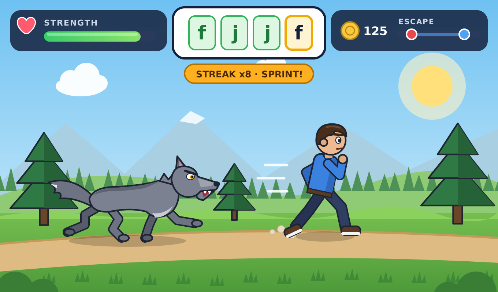

# D' Keys to Escaping

A touch-typing adventure for ages 15 to 50. Your own cartoon runner is in danger, and the only
way out is to type fast and accurately. Type quickly and you sprint away. Type slowly and the danger
closes in. Hit a wrong key and you trip or lose your grip.

It's plain HTML, CSS and JavaScript, with no build tools and no server. Everything is saved on the
device with `localStorage`. You can install it as an app, and it works offline after the first visit.

## How to play

1. Open the game's GitHub Pages link, or open `index.html` directly. Offline mode and installing
   need the web link, not a local file.
2. Pick **EN** or **ES** at the top right, then click **+ New player**. Choose **Male** or
   **Female**, then pick a skin tone, hairstyle, clothes and colors.
3. Pick your settings (you can change them later with **⚙** on the map):
   - **Menu language** and **Typing language**: English or Spanish, chosen separately.
   - **Verse mode**: sentence and boss levels use exact Bible verses. English uses the KJV and
     Spanish uses the Reina-Valera 1909.
   - **Mode**: *Practice* has no danger. *Challenge* has the danger.
   - **Win style**: *Speed goal* means you finish with at least 90% accuracy **and** the level's
     minimum WPM. *Survival* means you reach the finish line alive.
   - **Device**: *Auto*, *Laptop* or *Phone*. **Finger guide**, **Sound**, **Music**, and
     **Blood** (off by default).
4. On the level map, tap the glowing level. Your runner walks there and the briefing opens.
5. Type the characters in the tiles at the top. A wrong key counts as a mistake, and you have to
   type the right key before you can move on.
   - **Streak**: 8 correct keys in a row makes you **SPRINT**.
   - **Chase**: a wolf, boar, cheetah, bear, bull, panther, rolling rock, lava or avalanche runs
     after you.
   - **Falling**: things drop on you. Each one has a ring with a number. Type that many correct
     keys before it lands.
   - **Hold-on**: hold up a boulder or climb a vine. Your strength keeps draining and every
     correct key gives some back.
   - **👑 Boss**: the last level of every world is a longer, harder chase that uses every key you
     have learned so far.
   - **💖 Revive**: once per level in Challenge mode, if your strength runs out you can pay 30
     coins to get back up.
6. Press **?** during a level to see the Key Guide card for the next key. Press **❚❚** or **Esc**
   to pause.
7. The results screen shows WPM, accuracy, best streak, stars and coins, plus a "Did you know?"
   fact in your menu language. When you beat a world's boss you get a **printable certificate**.

### Stars
- ★: you won the level.
- ★★: 95%+ accuracy and at least the minimum WPM.
- ★★★: 98%+ accuracy and 125% of the minimum WPM. In Challenge mode you also need at least half
  your strength left.

## 🎹 Piano Challenge (new)

Click **🎹 Piano Challenge** on the start screen (or **🎹** on the map). Pick a song: tiles fall in
columns, and each column belongs to one letter key. Press a tile's letter when it reaches the gold
line, and the piano plays the next notes of the piece. Keep going and the music plays perfectly. Stop
and the music stops. When the piece has several notes at once, one key plays the whole chord. Higher
notes appear in columns further right and lower notes further left, so the tiles follow the shape
of the melody.

| Difficulty | Columns (keys) | Songs |
|---|---|---|
| Beginner | F J | 17 traditional songs and hymns |
| Easy | D F J K | Handel and Bach melodies |
| Medium | S D F J K L | Jesu Joy, Air on the G String, Sarabande HWV 437, Alla Hornpipe, Mozart K. 545 (2nd mvt, opening theme) |
| Hard | A S D F J K L ; | Bach BWV 846, 999, 996, Badinerie, Queen of Sheba, Harmonious Blacksmith, K. 545 Rondo |
| Expert | A S D F J K L ; | Bach Inventions 1, 4, 8, 13, 14, BWV 847 Prelude and Fugue, Italian Concerto, Toccata BWV 565, Passacaglia HWV 432, K. 545 1st mvt complete |

- **Challenge mode**: 3 mistakes (wrong keys or missed tiles) end the song, and you still see your
  results. **Practice mode** (from the player's settings): the tiles stop and wait for the right
  key, and there's no game over.
- **Speed**: each song speeds up as it goes: about 30% faster by the end in Challenge, and from 85%
  to 105% in Practice.
- **Scoring**: every tile scores up to 100 points for timing, multiplied by your combo. You also
  get accuracy, 1 to 3 stars (★ finish, ★★ 90%+, ★★★ 97%+ with no missed tile) and coins for the
  wardrobe shop.
- **Unlocking**: songs unlock in order. Finishing a song unlocks the next one. Each player's best
  score, stars and plays are saved, and the stats page and parent view show how many songs are
  finished.
- **Phone mode**: up to 4 columns (D F J K), letters only, typed with the phone keyboard. The play
  area fits above the keyboard.
- **Sound**: the piano is a real recorded grand piano (Salamander Grand Piano). The game only loads
  the notes a song needs, and they are cached for offline play. **Volume** is in Settings.
- **Sources**: every song comes from public-domain MIDI, MusicXML or ABC files. See `CREDITS.md`
  and `tools/build_songs.py`. No song was written from memory, so none is marked "needs checking".

## Worlds

| World | Keys | Hazards | Who sees it |
|---|---|---|---|
| Whispering Forest | F J, D K | wolf chase, vine climb | everyone |
| Coconut Jungle | S L, A ; | falling coconuts, vine, boar chase | everyone |
| Golden Savanna | G H, E I | cheetah chase, boulder | everyone |
| Rumbling Cliffs | R U, T Y | boulder, vine, rolling-rock chase | everyone |
| Echo Caves | W O, Q P | falling rocks, boulder | everyone |
| Avalanche Peaks | C M, V N, X ,, Z ., B | avalanche chase, icicles | everyone |
| Escape Summit | mixed review | every level type | everyone |
| Capital Castle | capitals with the correct Shift hand | bear chase, falling rocks, boulder | everyone |
| Sunny Plaza | US-International setup, ñ, á é í ó ú, ü ¿ ¡ | bull chase, falling oranges, vine | Spanish typing language only |
| Number Volcano | 1–5, 6–0, review | lava chase, lava rocks | Laptop mode only |
| Symbol Storm | every symbol on a US keyboard | panther chase, hail | Laptop mode only |

Each lesson goes from single letters to letter combos, real words, then short sentences. Each
world ends with a boss. The text is regenerated every time you play.

## Other screens

- **👕 Shop** (wardrobe): spend coins on new tops, pants or skirts, and extra colors. Hats and
  accessories unlock as you win levels. Every item is modest, and male and female items are
  separate lists.
- **📊 Stats**: best speed, recent accuracy, levels completed, accuracy and speed over time
  (charts plus a table), most-missed keys, and your certificates.
- **🎯 Smart practice**: a round built from the keys you miss most often.
- **👪 Parent view** (start screen): every player's progress side by side.
- **⌨ Key Guide**: a card for every key, covering letters, capitals and Shift, numbers, all
  symbols, and the Spanish letters with the US-International keyboard steps.

## Spanish on a US keyboard (Windows)

The Sunny Plaza world starts with a lesson on adding the **United States-International**
keyboard: Settings → Time & language → Language & region → *your language* → Language options →
Add a keyboard → United States-International. Press Windows + Space to switch keyboards. Then:

- `~` then `n` = **ñ**
- `'` then a vowel = **á é í ó ú**
- `"` then `u` = **ü**
- Right Alt + `/` = **¿**
- Right Alt + `1` = **¡**

On phones, press and hold a letter to pick ñ or an accented letter.

## Install as an app

On Chrome or Edge (laptop, Android or tablet), click the **⬇ Install app** button on the start
screen or the install icon in the address bar. On iPhone or iPad, use Share → **Add to Home
Screen**. After the first visit the game works offline.

### Safety for other games on the same GitHub Pages site
- `manifest.webmanifest` uses `"start_url": "./"` and `"scope": "./"`. Both are relative, so they
  point to this repository's folder (for example `/Typing-game/`) and never to the site root.
- The service worker is registered as `./sw.js` with `{ scope: './' }`, and it ignores every
  request outside its own folder (apart from the Google Fonts the game uses).
- Every cache it creates starts with `dkeys-`. On update it only deletes caches that start with
  `dkeys-`.
- `sw.js` has a `VERSION` (now **3.1.0**), and the version is also shown on the start screen. **When you change
  the game, bump `VERSION` in `sw.js`** (and `APP_VERSION` in `js/ui.js`). The worker fetches
  from the network first and uses the cache when offline, so a normal refresh shows the update.

## Publishing on GitHub Pages

1. Push this folder to a GitHub repository. `index.html` must be at the root.
2. On GitHub, open **Settings → Pages**.
3. Under **Build and deployment**, choose **Deploy from a branch**. Pick **main** and **/(root)**,
   then click **Save**.
4. Wait about a minute. The game will be live at `https://<your-user>.github.io/<repo-name>/`.

There's no build step. The empty `.nojekyll` file tells Pages to serve the files as they are.

## Verse sources

The verses are never typed by hand. `data/sources/` holds the original public-domain files from the
[scrollmapper/bible_databases](https://github.com/scrollmapper/bible_databases) project, which
is built from CrossWire modules:

- `KJV.csv`: King James Version (1769)
- `SpaRV1909.csv`: Reina-Valera (1909), listed there as "SpaRV"

`tools/build_verses.py` copies verses byte-for-byte into `data/verses-en.js` (7,630 verses) and
`data/verses-es.js` (7,938 verses). It only *chooses* verses: it uses Psalms, Proverbs,
Ecclesiastes, Isaiah, Matthew, John, Romans, 1 Corinthians, Galatians, Ephesians, Philippians,
Colossians, James and 1 John, keeps verses 25–230 characters long, and skips chapter-opening
verses and any verse with characters a keyboard can't type. A check confirmed every generated verse
matches its source text exactly. See `data/sources/SOURCE.md`. To rebuild, run
`python3 tools/build_verses.py`.

## Files

- `index.html`: all the screens
- `css/style.css`: game UI styling, the responsive layout and the print layout for certificates
- `js/i18n.js`: menu text in English and Spanish
- `js/data.js`: Stage 1 lessons, worlds, English words and sentences, facts, and the keyboard map
  (including Shift, AltGr and dead keys)
- `js/data2.js`: Stage 2 lessons and worlds, Spanish words and sentences, number and symbol
  practice, shop items, and Spanish facts
- `js/store.js`: profiles in localStorage (moves Stage 1 saves to the new format), plus sound
  effects and music
- `js/art.js`: all canvas drawing: runners, clothes, hats, accessories, creatures, hazards and
  scenes
- `js/game.js`: level lists, the text and verse generator, and the game engine (bosses, revive,
  Shift checks)
- `js/ui.js`: menus, map, shop, stats, parent view, certificates, key guide, input and install
- `manifest.webmanifest`, `sw.js`, `icons/`: the installable, offline app
- `data/`: verse files and their public-domain sources
- `tools/build_verses.py`: builds the verse files
- `js/piano.js`: Piano Challenge (piano sound, falling tiles, song menu, results)
- `js/songs.js`: the 59 songs, generated by `tools/build_songs.py` from `music/sources/`
- `audio/piano/`: the 21 piano samples
- `CREDITS.md`: sources and licenses for the songs, the piano samples and the verses
- `GAME_DESIGN.md`: the Stage 1 and Stage 2 briefs, plus the Piano Challenge brief

## Choices made during Stage 1

- **Art is drawn in code** with Canvas 2D in the style of the reference images. Knees and elbows
  bend the right way.
- **Clothing**: male runners get shirts, T-shirts, hoodies or jackets with pants. Female runners
  get blouses, tunics or cardigans with long skirts over dark leggings. Male and female items are
  never mixed.
- **The bottom row is split into five lessons**: C M, V N, X comma, Z period, and B.
- **Wrong keys never skip ahead.** In Chase levels a mistake lets the danger get closer. In
  Falling levels an extra object drops. In Hold-on levels you lose grip strength.
- **Being caught** costs 25 strength. You only lose when your strength reaches 0.
- **Minimum speed** starts at 7 WPM and rises about 1 WPM per lesson. The danger moves at that
  speed.
- **Practice mode** still unlocks levels and earns half the coins.
- **Phone mode** uses letters and space only, hides the on-screen keyboard, and shows simpler
  scenes. A hidden input opens the phone keyboard.

## Piano Challenge update (v3.1.0)

- **Bug fixed**: on slow songs, the first key started the music but also took away a life. The
  first correct key now plays the first tile, and pressing the right key a little early never costs
  a life.
- **🎼 Sheet music**: open a song, then press **Show sheet music** under the Start button. You see a
  simplified score (treble and bass staff, with the song's key and time signature) made from the
  same notes you will play.
- **👆 Tap mode**: at the top of the song list, choose **Play with: Keyboard keys** or **Tap the
  tiles**. In tap mode the tiles have no letters, and you tap them with your finger or click them
  with the mouse, like the classic music-tiles games. It uses up to 4 lanes. Phones start in tap
  mode, and each player's choice is saved.
- **14 more Bach and Handel pieces**:
  - **Easy**: Minuet in G, Minuet in G minor, Lascia ch'io pianga, Air from Water Music, Aylesford
    Menuet in D.
  - **Medium**: Musette in D, Gavotte in G HWV 491, Aylesford Air and Passepied, La Réjouissance,
    and the Royal Fireworks Bourrée.
  - **Hard**: Cello Suite No. 1 Prelude, and the Sleepers, Wake! chorale prelude BWV 645.
  - **Expert**: Fugue in C minor BWV 847.
  - The two Minuets and the Musette come from the Notebook for Anna Magdalena Bach. They have long
    been credited to Bach, but the Minuets are now thought to be by Christian Petzold, and the
    game says so.
  - All 14 come from public-domain source files (see `CREDITS.md`). There are 59 songs in total.
- **Songs you already finished stay open** even when new songs are added before them.
- **Sarabande fix**: the Sarabande HWV 437 is now moved to D minor using its file's key signature.
  The earlier build had used the wrong interval.

## Changes after Stage 2 (your feedback)

- **Chases feel faster**: your runner stays in the same spot on screen. When you type faster, the
  legs move faster and the background scrolls by faster. The chaser speeds up steadily and is 30%
  faster by the finish line, so you have to keep typing faster. Each wrong key makes it lunge about
  60% further than before.
- **The boulder is now a roof**: the posts of a hut or house have broken and your runner holds the
  roof up. The roof sinks as your strength drops. If your strength runs out, it falls with a cartoon
  dust cloud and dizzy stars. When you win, a new post slides in and the runner steps out. The roof
  matches the world: a wooden cabin, a thatched hut, terracotta tiles, a stone lintel, a castle gate,
  or a snowy cabin.

## Choices made for Piano Challenge

- **How hitting works**: the right key counts if the tile is less than 1.4 seconds above the line,
  and hitting early pulls the music forward to that tile. In Challenge, a tile more than 0.32
  seconds past the line counts as missed. A wrong key costs one of your 3 lives.
- **Timing**: hits within 0.09 s are perfect (100 points), within 0.2 s great (80), and anything
  else good (60). The combo multiplier is up to 3×.
- **Coins**: a finished song pays 15 per star plus 1 per 10 tiles. Practice pays half.
- **Columns**: Medium uses 6 keys, and Hard and Expert use 8. Phone mode always uses at most D F J
  K, and never `;`.
- **Simplified versions**: easier songs follow the melody (with chords where the source has
  harmony). Long pieces are cut to a playable excerpt, apart from the complete K. 545 1st movement.
  The Sleepers, Wake! chorale uses Bach's 4-part setting from BWV 140.
- **Sound**: if the piano samples can't load (for example when you open `index.html` as a local
  file), a soft synthesized tone plays instead.
- **Saving**: piano progress is saved in each player's `piano` field.

## Choices made during Stage 2

- **Level ids**: progress is saved by level id (such as `forest-3`) instead of by number. Stage 1
  saves move over automatically and nothing is lost.
- **Unlocking**: a level unlocks when the level before it is won. The world list depends on the
  typing language (Sunny Plaza is Spanish-only) and the device (numbers and symbols are
  laptop-only), so switching either one never locks levels you already won.
- **Shift hand**: in Laptop mode the game reads which Shift key is held. Using the Shift on the
  same hand as the letter counts as a mistake, and a hint says which Shift to use. If Caps Lock is
  on, the key is ignored and a reminder is shown, so it doesn't count as a mistake.
- **Characters you haven't learned are typed for you.** When a verse or sentence has a character
  you haven't learned yet (or can't type on a phone, like digits or ¿), the game fills it in and
  shows it in grey italics. This keeps verses word-for-word exact while you only type keys you
  know. The closing `?` and `!` in the Spanish ¿¡ lessons are also typed for you until Symbol
  Storm.
- **Verse mode** replaces the "short sentences" levels and bosses once you know 12 or more
  letters. Bosses use 2 or 3 consecutive verses, and the reference is shown under the text and on
  the results screen. Number and symbol worlds keep their own practice text so you still type
  digits and symbols.
- **Verse spelling**: in the CrossWire KJV the small-capitals "LORD" is written as "Lord". The
  Reina-Valera 1909 keeps its original spellings (*fué*, *á*). Both are exactly as in the source.
- **Dead keys**: in Laptop mode the game waits after a US-International dead key and highlights
  the second key. It accepts the combined character (á, ñ, …) that the keyboard sends.
- **Boss levels** need 120–340 characters (about 170 when not using verses), the danger is 20%
  faster, they pay 40 bonus coins, and winning one for the first time gives the world certificate.
- **Revive** costs 30 coins and is only offered in Challenge mode. You get 70 strength back and the
  danger is pushed back.
- **Shop prices**: tops 100–220 coins, pants or skirts 80–120, extra colors 40 each. Colors you
  buy work for every part of the outfit. Hats and accessories unlock after you win 3, 5, 8, 12, 15,
  20, 25, 30 or 40 levels. Female hats include a headscarf. Every item is modest, and male and
  female item lists are separate.
- **Smart practice** ranks keys by how often you miss them (at least 2 misses) and builds a chase
  round from the top six keys you have already learned. It pays half coins and doesn't change
  level progress.
- **Stats** has one chart for accuracy and one for WPM, each with its own scale, plus a table of
  your last 10 plays.
- **Parent view** has no PIN. It only reads data stored on this device.
- **Spanish facts** are translations of the same facts, plus four facts about typing Spanish
  letters.
- **Polish**: screens fade in, the map walk eases in and out, the screen shakes a little on a
  mistake, the escape bar moves smoothly, and there are new sounds for revive, coins, buying,
  dodging and certificates. The music loop is longer and has a light hi-hat.
- **Testing**: everything was tested with automated play in headless Chromium at 1280×800,
  1100×700 and phone sizes (390 px wide). This covered Stage 1 levels, capitals, Spanish accents
  and dead-key highlights, numbers, symbols, bosses, verse mode in both languages, revive, the
  shop, stats, parent view, certificate printing, moving an old Stage 1 save, the service worker
  scope and caches, and reloading offline. It has not been tested on a real phone, tablet or
  Windows keyboard yet.
